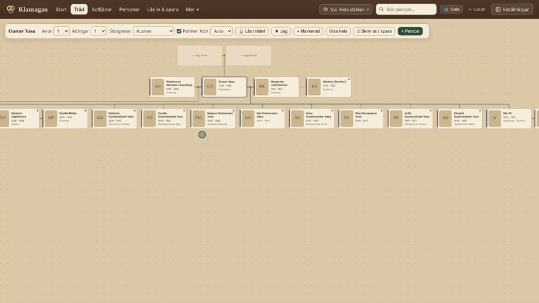
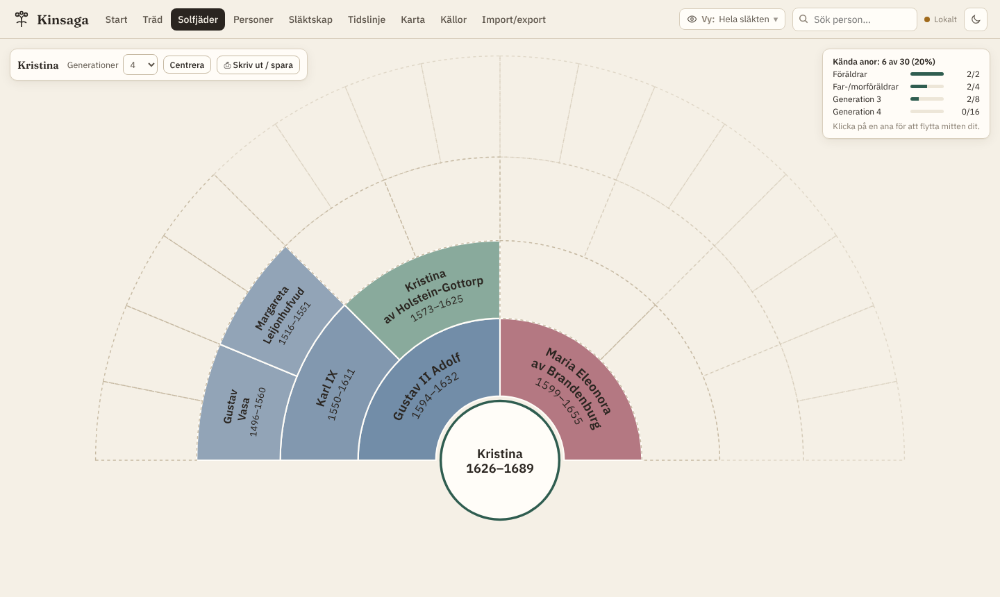
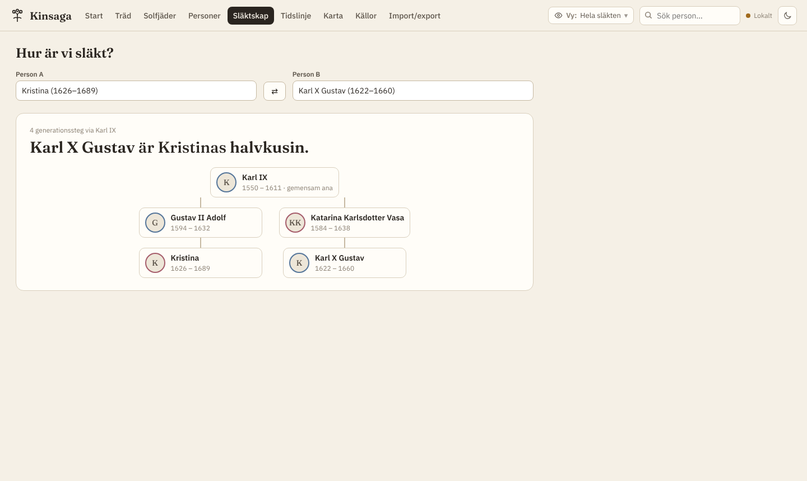
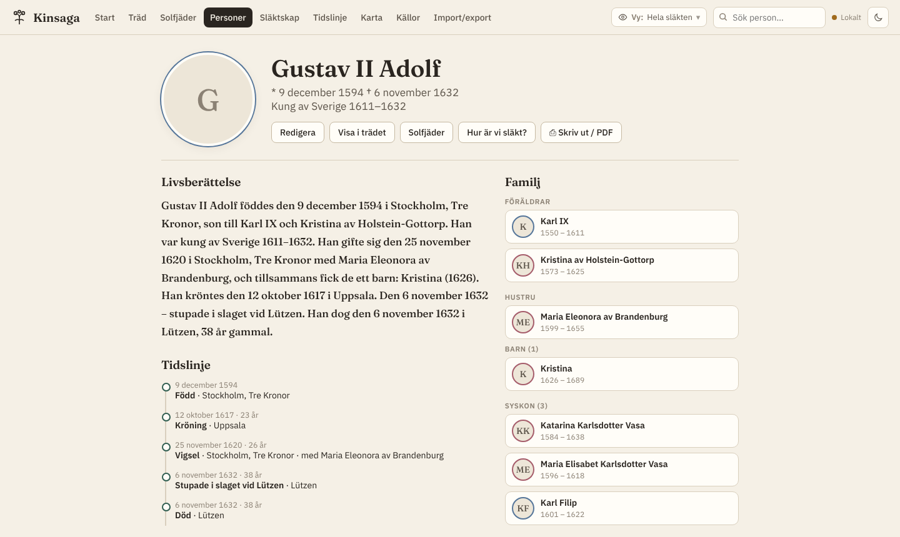
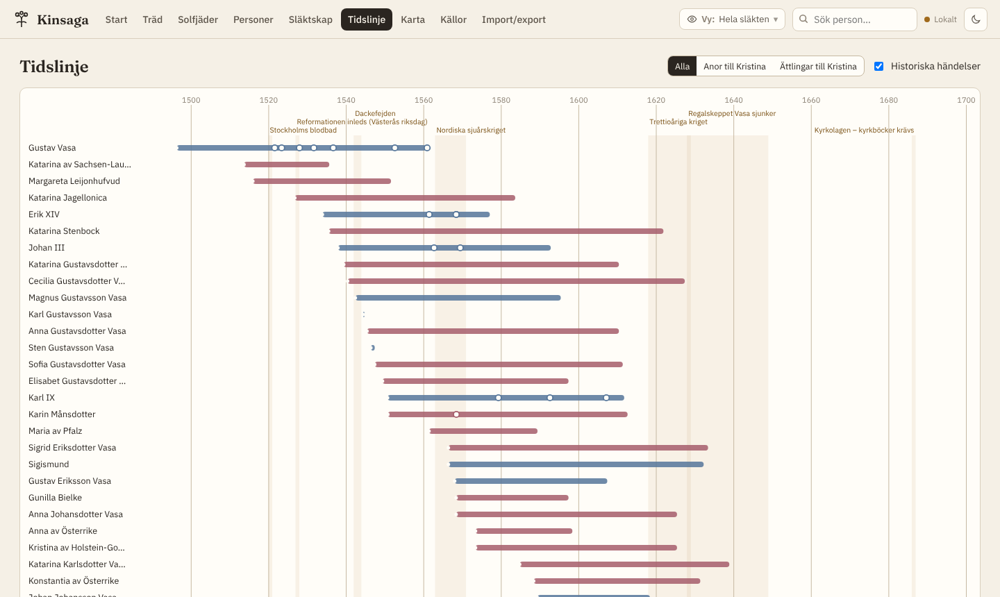
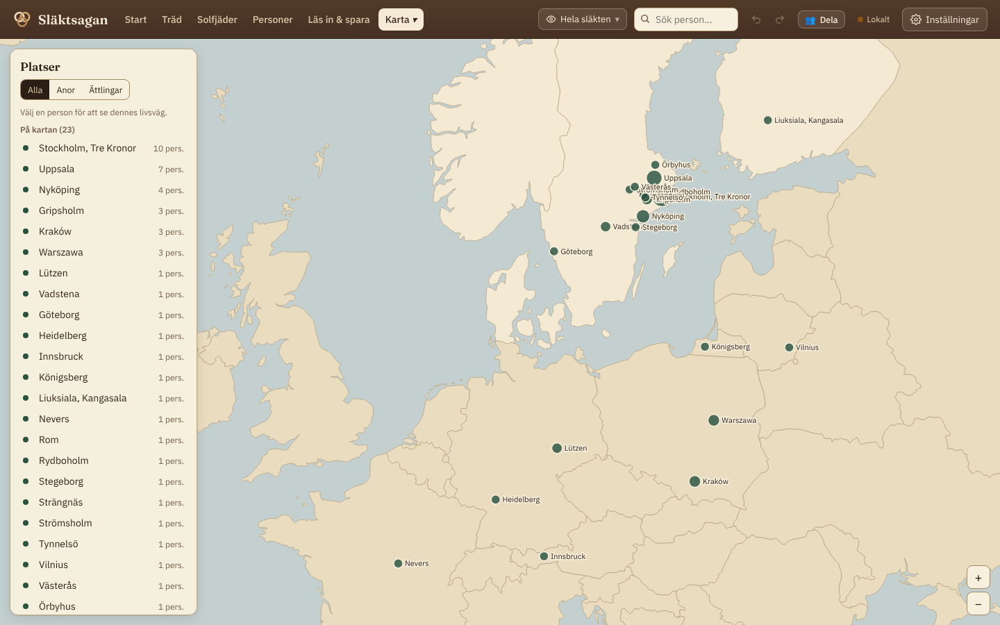
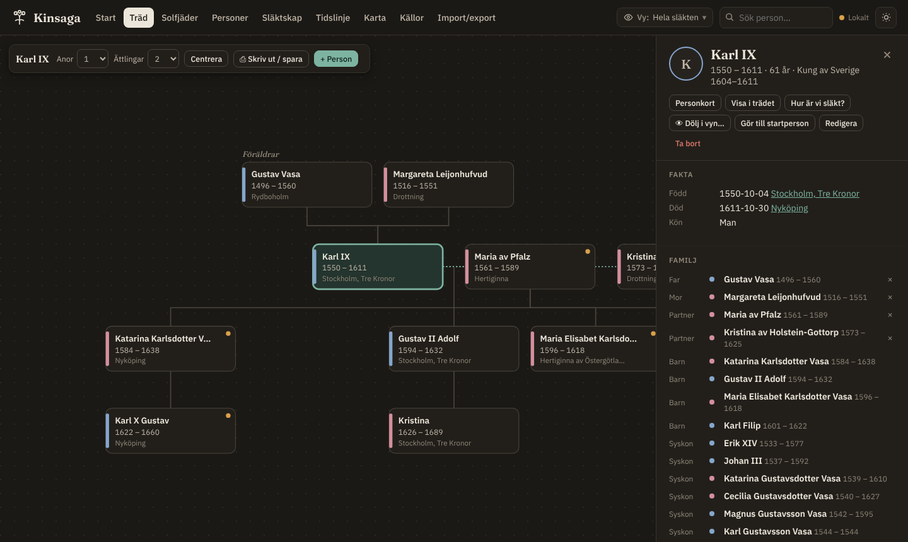

# Släktsagan

[](https://github.com/godvig/slaktsagan/actions/workflows/ci.yml)
[](LICENSE)


**Build your family history together.** Släktsagan is a browser-based genealogy workbench: family tree, fan chart, sources, timeline, map and auto-written life stories. It runs from a single static page, needs no account and keeps your data in your own hands.

*Släktsagan* is Swedish for "the family saga" (*släkt* = family, relatives). The repository is `slaktsagan` because GitHub names can't contain å/ä/ö.

Most genealogy tools are either subscription platforms that own your tree, or desktop programs that look like 2005 and can't be shared. Släktsagan is for the person who does the research for the whole family. You document every fact with its source, then share **the part of the tree each relative cares about**. Cousins on dad's side don't have to scroll through mum's side.

The interface is in Swedish for now, and it understands Swedish sources (household examination rolls, parishes, patronymics). An English UI is next on the [roadmap](#roadmap).



*Click someone and the family rearranges around them; ask how two people are related and the chain lights up in the tree. Try it on the [House of Vasa example](https://klansagan.godvig.com/#exempel).*

| Fan chart | Relationship calculator | Person card |
|---|---|---|
|  |  |  |
| **Timeline** | **Map with life route** | **Dark mode** |
|  |  |  |

## Live demo

**[Open the example](https://klansagan.godvig.com/#exempel)**: the Swedish royal House of Vasa, from Gustav Vasa (1496) to Queen Christina and Charles X Gustav, with coronations, marriages, places and sources. The example lives in memory only and is never saved. [Open an empty archive](https://klansagan.godvig.com/) to start with your own family.

## Quick start

There is no build step. Serve the folder with any static web server:

```bash
git clone https://github.com/godvig/slaktsagan.git
cd slaktsagan
python3 -m http.server 8000      # or: npx serve .
```

Open <http://localhost:8000>. Opening `index.html` directly from disk won't work, because the map data is loaded with `fetch`.

To import your own family, start from [`examples/slaktsagan-import-example.xlsx`](examples/slaktsagan-import-example.xlsx). It has one row per person, and parents are referenced by id or by name.

## Features

- **Family tree:** ancestors and descendants around any person, up to 10 generations each way. Couples follow genealogical convention (man left, woman right), and cards stay put when you move between partners.
- **Fan chart:** ancestors in a half circle, coloured by grandparent line, with completeness per generation.
- **Person cards:** an automatically written life story ("…was born on 12 May 1496 at Rydboholm… married… died aged 64"), plus family, a vertical timeline with age at each event, photos and sources.
- **Relationship calculator:** precise Swedish kinship terms (farbror, moster, brorsdotter, kusin, tremänning, halvkusin, svåger…) with the path drawn through the common ancestor.
- **Sources:** register each register volume once (archive, reference, image id) and cite it per fact.
- **Timeline:** lifespans against historical events (plague, famine years, emigration, wars).
- **Map:** places on a map, with a person's life route. Place a parish by clicking the map and merge spelling variants.
- **Views:** hide a branch ("dad's side only"), single people or descendants. Each view has its own link, and nothing is deleted. One click undoes a change.
- **Several trees in one archive:** families that aren't connected yet show up as separate trees. Link them with a plain-language sentence ("Anna *is the mother of* Ellen"), or accept a suggested match when the same person appears in both.
- **Duplicate finder:** catches spelling variants (Gustaf/Gustav, Wasa/Vasa, Larsdtr/Larsdotter) and merges the records safely.
- **Import:** GEDCOM 5.5 / 5.5.1 / 7 from any genealogy program (Disgen, MyHeritage, Ancestry, Geni, Holger, Legacy…), including the old ANSEL and IBM PC character sets Swedish programs used, the `*` call-name marker, dates like `ABT`/`BET … AND …`, coordinates, notes, sources with page references and marriages. A preview shows what was found before anything is saved; places and sources the archive already has are reused, and the whole import is one undoable step. Excel, CSV or cells pasted from Excel work too, with columns mapped automatically from Swedish or English headers.
- **Export:** GEDCOM 5.5.1 (MyHeritage, Ancestry, Gramps, Disgen…), CSV and a JSON backup. The tree, fan chart and person cards print as PDF (A3/A4) or PNG.
- **Collaboration:** when hosted as a Claude artifact, invited relatives edit the same tree live, and every change records who made it.
- **Works on phones:** a bottom tab bar, a compact tree toolbar, person details as a sheet, touch zoom and pan.
- **Easy to use:** a start page with three clear choices and a *simple mode* (big text, only Start, Tree and People) that a link can switch on with `?enkelt`. Mark yourself as "me" and kinship is counted from you. Light by default, dark mode on request.
- **Call names (tilltalsnamn):** mark the name a person went by. It is underlined Swedish-style, and you can show short names everywhere (call name, or the first given name).
- **Show the path in the tree:** the relationship calculator ("Hur är vi släkt?") opens the tree around the shared ancestor and lights up the chain between the two people, couples included, and dims everyone else.
- **Backups:** a local archive lives only in the browser, so *Import & export* shows when you last saved a backup and how much has changed since, and the app reminds you (at most every few days) when you have never saved one or it is two weeks old with changes. The backup is one JSON file with everything, photos and voice memories included, and reads straight back in.
- **Photos straight onto people:** drag an image onto a card in the tree (or the person panel), paste one with Ctrl+V while someone is selected, or tap the empty photo on a card; on a phone that offers the camera. The first photo becomes the profile picture and is framed on the face.
- **Undo everything:** every change — an edit, a deleted person with all their links, a photo upload, a whole import — can be undone and redone with the ↶ ↷ buttons or Ctrl+Z / Ctrl+Shift+Z. Changes made in one go count as one step, and the toast says what was undone.
- **Animated tree:** when you click someone, they stay put under your cursor while the rest of the family glides into its new places (and the view eases them back towards the middle if they ended up near an edge); relatives who leave the view fade out and new ones fade in. Respects *reduce motion*.
- **Voice memories:** record grandma telling a story straight from the browser (or upload an audio file) and attach it to a person, or to one of their photos. Recordings are small (Opus, about 180 KB a minute), kept on the device and, in shared trees, uploaded end-to-end encrypted like photos.
- **Thumbnails:** photos get a small thumbnail when uploaded, so the tree and lists load only a few kilobytes per person; the full image is fetched when you open it.
- **Photos framed on the face:** profile photos are centred on the face automatically (MediaPipe face detection, loaded on demand) and can be dragged and zoomed by hand.
- **Side branches:** the tree can show siblings, cousins, second cousins and further out, packed beside the direct line. On import, use a *Tilltalsnamn* column or an asterisk (`Lars* Anders`).

<details>
<summary><b>Swedish terms used in the interface</b></summary>

| Swedish | English |
|---|---|
| Träd / Solfjäder | Tree / Fan chart |
| Släktskap | Relationship |
| Källa, husförhörslängd | Source, household examination roll |
| Församling / socken | Parish |
| Far, mor, farfar, mormor | Father, mother, paternal grandfather, maternal grandmother |
| Farbror, faster, morbror, moster | Paternal uncle/aunt, maternal uncle/aunt |
| Kusin, tremänning, halv- | First cousin, second cousin, half- |
| Vy, dölj | View, hide |
| Startperson | Home person |

</details>

## Architecture

```
index.html          markup shell, loads D3 + topojson from CDN
src/core.js         pure logic: dates, GEDCOM parsing and dates, kinship terms, views, duplicate scoring, undo history
src/app.js          UI: views, panels, import/export, storage adapters
src/styles.css      design tokens (light + dark), layout
fonts/              Fraunces + IBM Plex Sans (woff2, SIL OFL), served from the site itself
data/world-50m.json Natural Earth countries (via world-atlas) for the map
examples/           fictional import files
tests/              Vitest suite for src/core.js
```

- **No framework, no bundler.** The app is vanilla JavaScript with [D3](https://d3js.org) for the tree, fan chart, timeline and map. [SheetJS](https://sheetjs.com) and [jsPDF](https://github.com/parallax/jsPDF) load lazily, only when you import or print.
- **Data model:** four document kinds (`person`, `place`, `source`, `view`) stored as flat JSON documents. Relationships live on the person (`fatherId`, `motherId`, `spouseIds`), and events and citations are embedded.
- **Storage adapters:**
  - IndexedDB when the app runs standalone, such as on GitHub Pages: the archive text and photos, with no 5 MB cap (archives from older versions are moved over from `localStorage` automatically). Edits made just before a tab closes are also written synchronously as an emergency copy, so nothing is lost.
  - A realtime document store with per-user attribution when it runs as a Claude artifact.
  
  The rest of the app only sees an in-memory store.
- **Cheap redraws:** every data change bumps a revision counter; the tree and person list compare it with what they last drew, so selecting someone only moves a highlight instead of rebuilding hundreds of cards (77 ms → 5 ms on a 1,500-person archive).
- **Views** filter the store before rendering. All writes, exports and merges always operate on the full, unfiltered data, so hiding something can never orphan or overwrite it.
- **Pure core:** everything that has a right answer (kinship terms, date handling, duplicate scoring, view filtering) lives in `src/core.js` and is unit tested.

## Tests

```bash
npm ci
npm run check     # eslint + tsc (JSDoc types on core.js) + vitest
```

CI runs the same checks on every push and pull request. The test suite covers Swedish kinship terms (including half and removed relationships), date parsing, GEDCOM import (character sets, dates, families, sources) and export dates, the undo history, CSV/Excel paste parsing, duplicate scoring and branch hiding, all on synthetic families.

## Sharing (end-to-end encrypted)

**Dela** creates a link you send to relatives. The tree is encrypted in the browser with AES-256-GCM; the key sits in the link's `#fragment`, which browsers never send to a server. Supabase stores only ciphertext and checks a write secret derived from the key, so neither the host nor the site owner can read a shared tree.

Everyone with the link can edit a local working copy and **publish** when ready. If two people publish in parallel, the second publish merges document by document (three-way merge); when both changed the same person, the newer edit wins. The server keeps the last 30 versions. Leaving the page with unpublished edits asks first, coming back to them shows a reminder with a Publish button, and so does sitting on them for ten minutes.

Photos are kept in IndexedDB on each device and, in a shared tree, uploaded once each as separate encrypted blobs, so publishing never re-sends them.

To run your own: create a Supabase project, run the files in `supabase/migrations/` in order in the SQL editor, and put the project URL and publishable key in `src/config.js`. The publishable key is public by design: the tables are closed and only the `kl_*` functions are exposed.

## Roadmap

Done recently: undo/redo for every change, a reminder before leaving with unpublished changes, photos dropped straight onto tree cards, backup reminders, GEDCOM import, encrypted sharing with publish and merge, version history, photo storage with thumbnails, voice memories, animated tree, kinship path in the tree, archive in IndexedDB, self-hosted fonts, phone layout, installable offline app (PWA).

**Next, in order**
1. Swedish source templates (Riksarkivet, ArkivDigital)
2. Landing page for new visitors
3. Comment threads per person
4. Browser tests in CI; split `app.js` into modules
5. Locked tree, step 2: add a branch by clicking someone outside it
6. "On this day" on the start page; family book as PDF

**Later:** life path on the map, photo gallery on the person card, read-only share links with protection for living people, "what's new since your last visit", English UI.

## License

[AGPL-3.0](LICENSE) © Adam Englund. You can use, study and modify Släktsagan freely. If you run a modified version as a network service, you must share your source code too.

Fonts: [Fraunces](https://github.com/undercasetype/Fraunces) and [IBM Plex Sans](https://github.com/IBM/plex), both under the SIL Open Font License 1.1 (see `fonts/`). Map data: [Natural Earth](https://www.naturalearthdata.com) (public domain) via [world-atlas](https://github.com/topojson/world-atlas). The House of Vasa example is compiled from public historical sources (Svenskt biografiskt lexikon, Svenskt kvinnobiografiskt lexikon, the Royal Court). Dates follow the Julian calendar that Sweden used until 1753.
